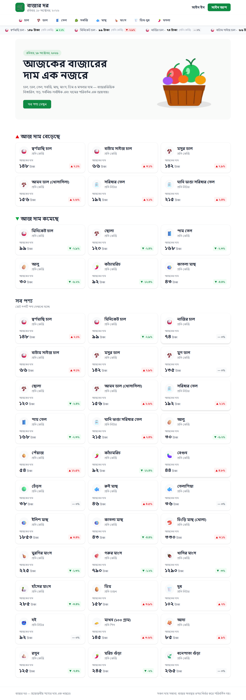

# 🛒 বাজার দর (BazarDor)

## ✨ Project Overview



বাজার দর is a modern Bangladeshi commodity price tracking web application designed to help users stay informed about daily market trends and make smarter purchasing decisions. It provides a clean, data-driven experience for tracking essential groceries, comparing prices, and monitoring market movement across categories.

## Live Link
https://assignment-7-coral.vercel.app/

---

## 🚀 Technologies Used

- **Next.js (App Router):** For modern routing, fast page navigation, and scalable application structure.
- **Tailwind CSS & DaisyUI:** For fast, responsive, and polished UI design.
- **BetterAuth:** For secure authentication and user profile management.
- **React Hot Toast:** For instant feedback alerts and notifications.
- **Local State & API Data Integration:** For dynamic market updates and interactive pricing insights.

---

## ✨ 5 Key Features

1. **Live Price Tracking**
   Monitor the latest commodity prices in a seamless ticker-style view with daily percentage changes.

2. **Market Trends Analysis**
   Easily identify products with the highest increases or decreases in price to understand current market movement.

3. **Smart Sorting & Search**
   Browse category pages with dynamic sorting that supports Bengali numerals and helps users compare products more efficiently.

4. **Detailed Product Analytics**
   View min, max, and average prices across local markets for a more complete picture of pricing trends.

5. **Secure Profile Management**
   Access protected routes and manage personal information safely through an authenticated user profile flow.

---

## 💻 Getting Started Locally

To run this project on your local machine, follow these steps:

### 1. Clone the Repository

```bash
git clone https://github.com/mehedi-hasandev/assignment-7.git
cd assignment-7
```

### 2. Install Dependencies

Make sure you have Node.js installed, then run:

```bash
npm install
# or
yarn install
# or
pnpm install
```

### 3. Run the Development Server

```bash
npm run dev
# or
yarn dev
# or
pnpm dev
```

### 4. Open in Browser

Open http://localhost:3000 to explore the app locally.

---

## 📌 Summary

বাজার দর is built to make everyday market decisions easier by offering transparent pricing insights, category-based comparisons, and a user-friendly dashboard for monitoring Bangladesh’s commodity market.
